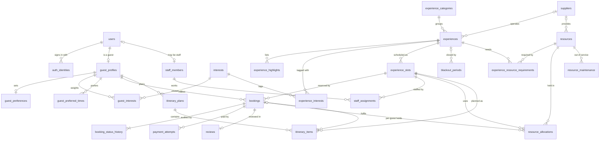
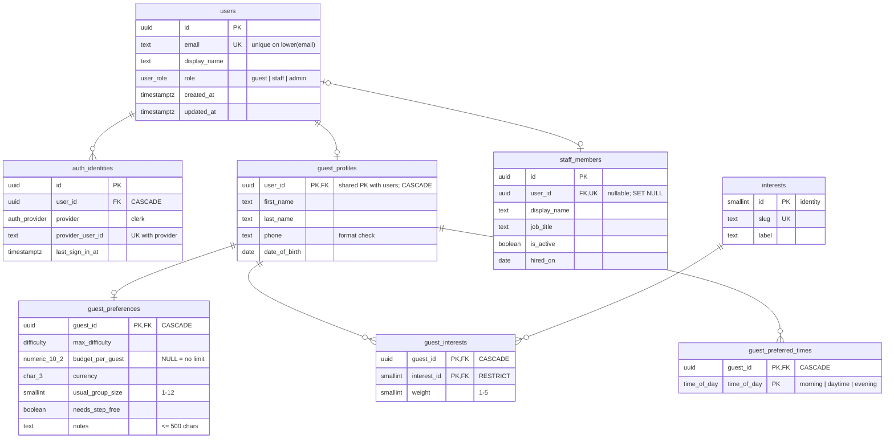
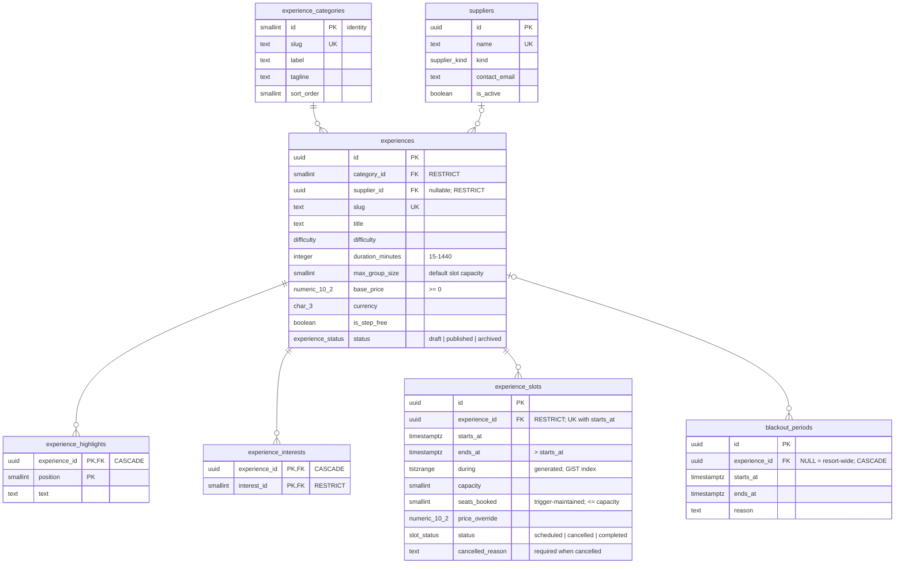
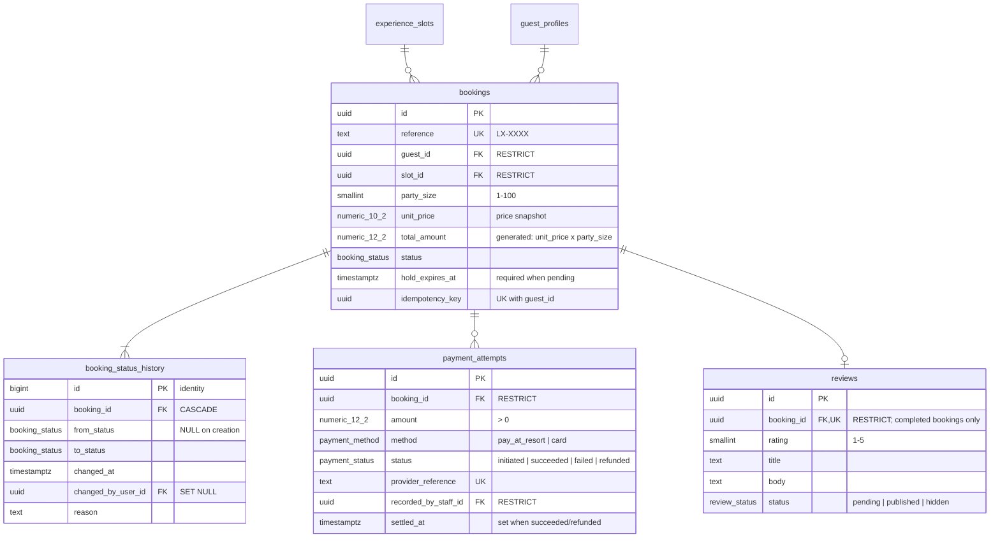
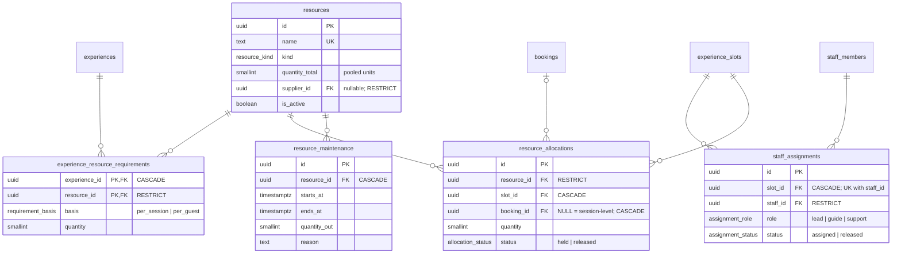
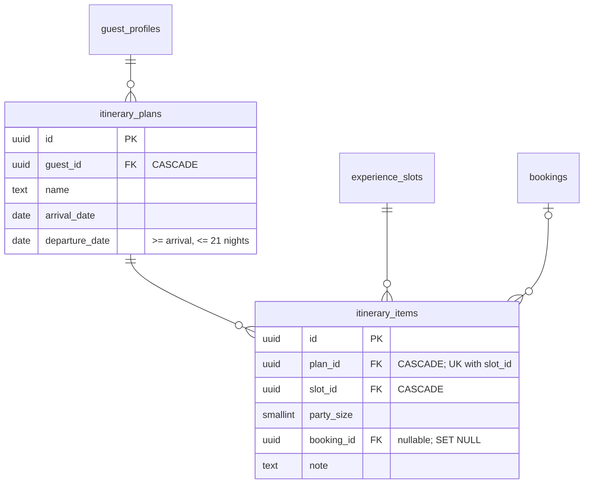
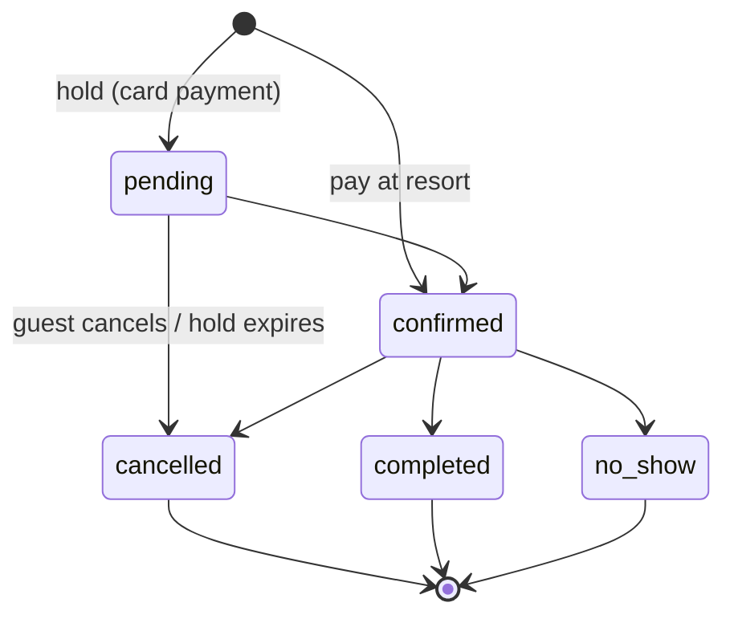

# LUXE-ECO Entity-Relationship Diagram

Source of truth: `lib/db/schema/*.ts` → migrations in `drizzle/`. Design rationale is in
[`DATABASE_DESIGN.md`](./DATABASE_DESIGN.md). 26 tables, 2 views.

Notation (Mermaid crow's foot): `||` exactly one · `|o` zero or one · `o{` zero or more ·
`|{` one or more. Keys: **PK** primary key, **FK** foreign key, **UK** unique.

## Overview

Audit and actor links (all `ON DELETE SET NULL`, omitted above for readability):
`booking_status_history.changed_by_user_id`, `blackout_periods.created_by_user_id`,
`reviews.moderated_by_user_id` → `users`; `payment_attempts.recorded_by_staff_id` →
`staff_members` (RESTRICT).

## Identity and preferences

## Catalogue and schedule

## Bookings, payments and reviews

Partial unique indexes: one *active* (pending/confirmed) booking per guest per slot; one
*succeeded* payment per booking.

## Staff and resources

Partial unique indexes: one active *lead* per slot; one session-level hold per resource
per slot.

## Itinerary

## Booking status lifecycle

Enforced by the `bookings_validate` trigger. Every status except `cancelled` holds seats
(`bookings_hold_seats`), and every change is written to `booking_status_history`.

## Views

| View | Purpose |
|------|---------|
| `slot_availability` | Each slot with experience, category, seats left and effective price per guest. |
| `experience_ratings` | Published review count and average rating per experience. |
