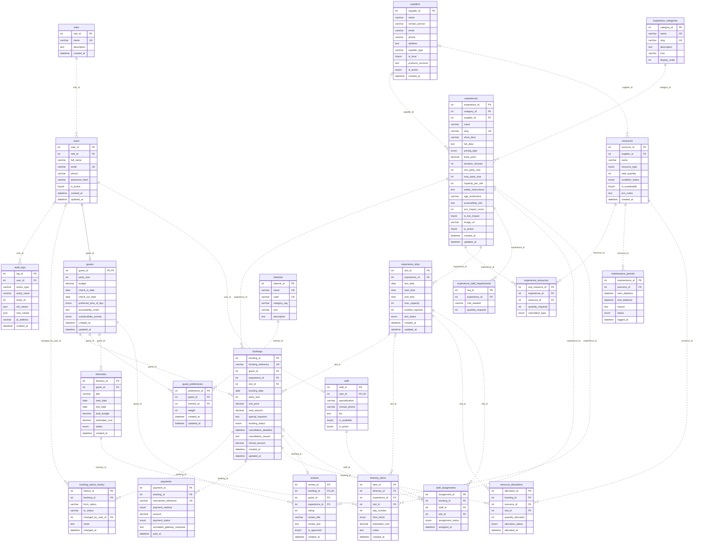
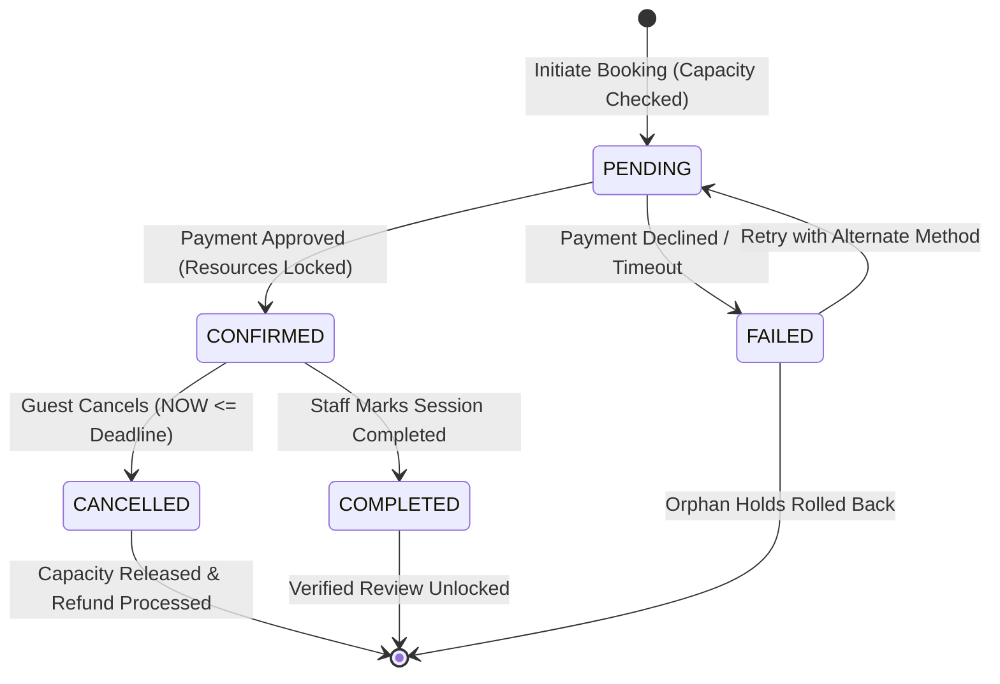
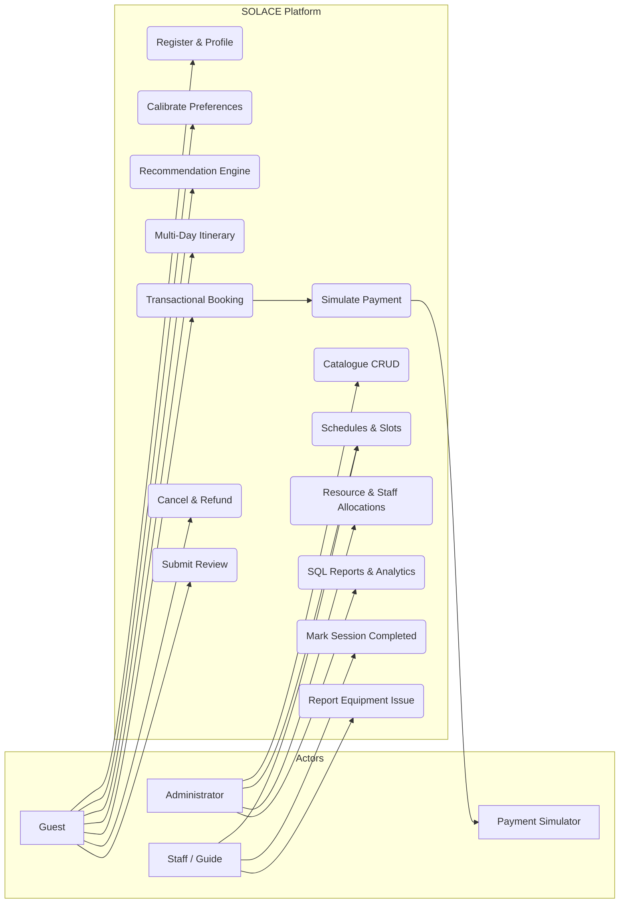

# SOLACE | Database Systems Diagrammatic Specifications
**Course:** Third-Year Computer Engineering DBMS Academic Project  
**System:** SOLACE Personalized Luxury, Nature & Adventure Experience Management System

This directory contains standalone high-resolution SVG vector diagrams along with the complete editable Mermaid and text definitions for all required system models.

> **Update (Oct 2026):** `er_diagram.svg`, `relational_schema.svg`, `dfd_level0.svg` and `dfd_level1.svg` (plus PNG copies in `png/`) were re-exported from the running application's Database Explorer, which builds them from the live MySQL schema. The earlier versions showed only 12 of the 23 tables and contained a non-existent column (`preferred_tod`). The remaining UML diagrams (use case, sequence, activity, state, architecture) are conceptual and were not regenerated.

---

## 1. Directory of SVG Diagrams

| Diagram Name | File Link | Focus & Coverage |
| :--- | :--- | :--- |
| **A. Entity-Relationship (ER) Diagram** | [er_diagram.svg](er_diagram.svg) | 23 3NF normalized entities, attributes, PK/FK constraints, cardinality |
| **B. Data Flow Diagram Level 0** | [dfd_level0.svg](dfd_level0.svg) | Context-level external entities: Guest, Administrator, Staff, Payment Simulator |
| **C. Data Flow Diagram Level 1** | [dfd_level1.svg](dfd_level1.svg) | 7 sub-processes and 6 core relational data stores (D1 - D6) |
| **D. Unified Use-Case Model** | [use_case_diagram.svg](use_case_diagram.svg) | 16 system use cases partitioned across Guest, Admin, Staff & Simulator actors |
| **E1. Sequence: Recommendation Flow** | [sequence_recommendation.svg](sequence_recommendation.svg) | 5-factor weighted scoring, date filtering, and explanation generation |
| **E2. Sequence: Concurrency Booking** | [sequence_booking.svg](sequence_booking.svg) | Concurrency-safe slot locking (`FOR UPDATE`), gear reservation, payment settlement |
| **E3. Sequence: Payment Fail Rollback** | [sequence_payment_fail.svg](sequence_payment_fail.svg) | Payment decline compensation, transaction rollback without orphan allocations |
| **E4. Sequence: Cancellation & Release**| [sequence_cancellation.svg](sequence_cancellation.svg) | Cancellation deadline validation, capacity restoration, full refund calculation |
| **F. Activity Workflow Diagram** | [activity_diagram.svg](activity_diagram.svg) | End-to-end journey with decision diamonds for capacity, payment, and conflicts |
| **G. Relational Schema Architecture** | [relational_schema.svg](relational_schema.svg) | Complete physical schema topology showing table structures and relationships |
| **H. Booking State-Transition Model**| [state_transition.svg](state_transition.svg) | Finite State Machine (FSM): PENDING -> CONFIRMED -> COMPLETED / CANCELLED / FAILED |
| **I. 3-Tier System Architecture** | [system_architecture.svg](system_architecture.svg) | Presentation (Bootstrap/CSS/Chart.js), Logic (Flask Services), Data (MySQL 3NF) |

---

## 2. Editable Mermaid Source Definitions

### A. Entity-Relationship (ER) Diagram
Generated from `information_schema` of the live database (all 23 tables, 33 foreign keys). The same model is rendered interactively at `/dbms/er-diagram`.

### B. Booking Lifecycle State-Transition Model

### C. Use-Case Model

