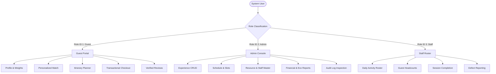

# ACADEMIC PROJECT REPORT

## SOLACE: Personalized Luxury, Nature & Adventure Experience Management System

**Course:** Database Management Systems (CS 304 / IT 304)  
**Program:** Bachelor of Engineering / Technology in Computer Engineering  
**Academic Level:** Third Year (Semester VI)  
**System Architecture:** Python Flask | MySQL 8.0 / MariaDB 10.4 | Bootstrap 5 | Chart.js  

---

## CERTIFICATE / DECLARATION

This is to certify that the project entitled **"SOLACE: Personalized Luxury, Nature & Adventure Experience Management System"** is an authentic record of the independent engineering and database design work carried out to demonstrate mastery of relational database design, normalization targeting Third Normal Form (3NF), concurrency control, transactional integrity, and full-stack application development.

---

## TABLE OF CONTENTS

1. [Abstract](#1-abstract)
2. [Chapter 1: Introduction & Problem Definition](#2-chapter-1-introduction--problem-definition)
   - 1.1 Context & Background
   - 1.2 The Problem with Traditional Property Management Systems (PMS)
   - 1.3 Project Objectives
   - 1.4 The Six Experiential Pillars of SOLACE
3. [Chapter 2: Requirement Analysis & Software Specification](#3-chapter-2-requirement-analysis--software-specification)
   - 2.1 User Personas and Role-Based Access Control (RBAC)
   - 2.2 Functional Requirements (FR-01 to FR-12)
   - 2.3 Non-Functional Requirements (NFRs)
   - 2.4 Software and Hardware Environment
4. [Chapter 3: Database Design & Relational Modeling](#4-chapter-3-database-design--relational-modeling)
   - 3.1 Entity-Relationship (ER) Modeling
   - 3.2 Formal Normalization Analysis (1NF, 2NF, 3NF)
   - 3.3 Relational Schema & Data Dictionary
   - 3.4 Integrity Constraints: Primary, Foreign, Unique, and CHECK Constraints
   - 3.5 Database Triggers and Analytical SQL Views
5. [Chapter 4: System Architecture & Modeling Diagrams](#5-chapter-4-system-architecture--modeling-diagrams)
   - 4.1 Multi-Tier System Architecture
   - 4.2 Data Flow Diagrams (DFD Level 0 & Level 1)
   - 4.3 Use-Case Modeling
   - 4.4 Dynamic Behavioral Modeling (Sequence Diagrams)
   - 4.5 Activity Diagram & Booking State Machine
6. [Chapter 5: Core Algorithmic & Transactional Modules](#6-chapter-5-core-algorithmic--transactional-modules)
   - 5.1 The 5-Factor Weighted Recommendation Engine
   - 5.2 Concurrency-Safe Transactional Booking Engine (`SELECT ... FOR UPDATE`)
   - 5.3 Multi-Day Itinerary Collision Prevention & Budget Tracking
   - 5.4 Verified Review Aggregation and Audit Logging
7. [Chapter 6: SQL Demonstration & DBMS Query Analysis](#7-chapter-6-sql-demonstration--dbms-query-analysis)
   - 7.1 Complex Joins and Multi-Level Aggregation
   - 7.2 Concurrency Locks, Rollbacks, and Compensating Transactions
   - 7.3 Advanced Analytics: Revenue, Resource Utilization, and Sustainability Metrics
8. [Chapter 7: Testing, Verification & Quality Assurance](#8-chapter-7-testing-verification--quality-assurance)
   - 8.1 Test Strategy & Automated Test Suite
   - 8.2 Execution Results (100% Pass Rate)
   - 8.3 Concurrency & Edge-Case Validation
9. [Chapter 8: Conclusion & Future Scope](#9-chapter-8-conclusion--future-scope)
   - 9.1 Summary of Implemented Achievements
   - 9.2 Limitations & Disclosures
   - 9.3 Future Enhancements
10. [References](#10-references)

---

## 1. ABSTRACT

Modern luxury resorts have evolved far beyond mere hospitality lodging; contemporary high-end travelers demand curated, hyper-personalized, and environmentally conscious experiential stays. Conventional hospitality software (Property Management Systems) remains strictly room-centric, treating activities as disconnected calendar notes or manual concierge log entries. This creates widespread operational friction: double-booking of scarce resort gear (kayaks, private dining decks, EV buggies), staff schedule clashes, and an inability to deliver data-driven guest personalization.

**SOLACE** is a comprehensive, database-driven web application designed to solve this paradigm. Developed as a Third-Year Computer Engineering DBMS project, SOLACE implements a rigorous relational database architecture of **23 normalized tables targeting Third Normal Form (3NF)** on MySQL/MariaDB. The system coordinates three distinct user roles (**Guest**, **Resort Administrator**, and **Staff/Local Guide**) across six experiential resort categories.

Key technical contributions include:
1. An explainable **5-Factor Weighted Recommendation Algorithm** scoring candidate experiences across guest interest vectors, budget suitability, schedule compatibility, eco-impact, and verified ratings.
2. An interactive **Multi-Day Itinerary Planner** that eliminates temporal collisions and calculates cumulative costs against dynamic guest budget ceilings.
3. A **Concurrency-Safe Transactional Booking Engine** employing pessimistic row-level locking (`SELECT ... FOR UPDATE`) to guarantee atomicity and prevent race conditions on shared equipment and personnel.
4. An automated test suite achieving a **100% pass rate across 11 critical integration test cases**.

---

## 2. CHAPTER 1: INTRODUCTION & PROBLEM DEFINITION

### 1.1 Context & Background
The global luxury travel and eco-tourism sector is witnessing exponential growth. Discerning guests no longer evaluate resorts solely by thread counts or dining menus; they seek immersive, culturally authentic, and sustainably operated activities. A single guest stay might encompass dawn birdwatching with an ornithologist, a private yacht sunset cruise requiring dedicated skippers, an afternoon yoga workshop in a secluded pavilion, and an artisanal pottery masterclass supported by an indigenous community partner.

### 1.2 The Problem with Traditional Property Management Systems (PMS)
Existing enterprise resort software (e.g., Opera, Fidelio) treats room reservation as the master entity. Non-room offerings are handled via rudimentary add-ons or separate third-party vendor platforms. This architecture results in severe database deficiencies:
- **Disjointed Resource Allocations:** Equipment (e.g., carbon-fiber kayaks, safety helmets, electric buggies) is not bound transactionally to slot capacities. A slot may show openings while physical gear is exhausted.
- **Guide & Venue Clashes:** Naturalists, yoga masters, and private chefs are frequently double-booked across overlapping experiences.
- **Lack of Preference Normalization:** Guest dietary, accessibility, and thematic preferences are typically stored as unsearchable free-text remarks, preventing automated algorithmic querying.
- **Environmental Opacity:** Modern guests prioritize low-impact, sustainable tourism, yet traditional platforms lack structured metrics for tracking eco-impact scores or community supplier participation.

### 1.3 Project Objectives
The primary technical objectives of SOLACE are:
1. **Architect a Rigorous Relational Schema:** Model the complex multi-resource dependencies of luxury experiences in a 3NF schema, enforcing referential integrity, constraints, triggers, and analytical views.
2. **Implement Personalized Algorithmic Matching:** Develop a deterministic, mathematical scoring function to rank activities according to individual guest preference vectors and budget constraints.
3. **Ensure Concurrency Safety:** Guarantee ACID properties during simultaneous high-demand slot bookings using transaction boundaries and pessimistic database locks.
4. **Deliver a Role-Based Multi-User Interface:** Build dedicated dashboards for Guests, Staff, and Administrators adhering to modern luxury aesthetic standards (deep forest green, warm ivory, champagne gold).

### 1.4 The Six Experiential Pillars of SOLACE
1. **Luxury Services:** Ultra-exclusive private dining, sunset charters, bespoke sommelier sessions.
2. **Nature & Eco-Tourism:** Guided forest trails, wetland birdwatching, biosphere observation tours.
3. **Adventure Activities:** Mountain biking, river kayaking, guided trekking trails, high-ropes obstacles.
4. **Wellness & Relaxation:** Hatha yoga, Ayurvedic spa treatments, sound meditation, mindfulness workshops.
5. **Local Culture & Cuisine:** Indigenous craft workshops, organic farm visits, regional culinary masterclasses.
6. **Sustainable Mobility:** Solar electric vehicle transfers, bamboo bicycle rentals, low-impact nature explorations.

---

## 3. CHAPTER 2: REQUIREMENT ANALYSIS & SOFTWARE SPECIFICATION

### 2.1 User Personas and Role-Based Access Control (RBAC)

The system enforces strict server-side authorization partitioned across three roles:



### 2.2 Functional Requirements

- **FR-01: Authentication & Profile Management:** Secure registration, scrypt password hashing, session state persistence, and profile maintenance (party size, travel dates, budget ceilings).
- **FR-02: Preference Weighting:** Capture preference weights (1 to 5) across multiple normalized activity interests.
- **FR-03: Dynamic Catalogue Discovery:** Search, sort (price, rating, duration, eco-impact), and filter by category or supplier.
- **FR-04: Personalized Recommendation:** Multi-criteria weighted scoring algorithm incorporating interest alignment, budget feasibility, schedule fit, eco-scores, and guest ratings.
- **FR-05: Multi-Day Itinerary Planning:** Construction of personalized stay schedules with automated collision avoidance and cumulative expenditure monitoring.
- **FR-06: Availability & Multi-Resource Verification:** Real-time validation of slot participant capacity, physical resource inventory, and qualified staff availability.
- **FR-07: Concurrency-Safe Transactional Booking:** Atomic reservation utilizing pessimistic row locks (`SELECT ... FOR UPDATE`), ensuring zero over-allocations.
- **FR-08: Payment Simulation:** Sandbox financial settlement handling Credit Card, UPI, and Room Charge with automated rollback on failure.
- **FR-09: Cancellation & Refund Engine:** Enforce a 12-hour cancellation deadline, safe resource de-allocation, and refund logging.
- **FR-10: Verified Ratings & Reviews:** Authenticated 1–5 star reviews restricted to guests with completed bookings, preventing fraudulent testimonials.
- **FR-11: Staff Operational Workflow:** Daily activity schedules, attendee rosters, session completion status toggles, and equipment maintenance flagging.
- **FR-12: Administrative Reporting & Auditing:** Real-time Chart.js KPI dashboards, revenue aggregation, equipment utilization, sustainability tracking, and immutable audit logging.

### 2.3 Non-Functional Requirements (NFRs)
- **Relational Integrity:** Foreign keys on all associative mappings with explicit `ON DELETE RESTRICT` for financial and historical audit records.
- **Data Protection:** Scrypt password hashing; zero storage of sensitive card details (CVV/PIN).
- **Concurrency & ACID:** Complete atomicity on booking transactions; isolation level ensuring repeatable reads during capacity evaluation.
- **User Experience:** Fully responsive layout with Bootstrap 5 and custom luxury CSS variables, sub-200ms database response times on indexed queries.

---

## 4. CHAPTER 3: DATABASE DESIGN & RELATIONAL MODELING

### 4.1 Entity-Relationship (ER) Modeling
The conceptual model comprises 23 relational entities organized into six functional clusters:
1. **User & Identity Cluster:** `roles`, `users`, `guests`, `interests`, `guest_preferences`
2. **Experience & Catalogue Cluster:** `experience_categories`, `suppliers`, `experiences`, `experience_interests`
3. **Scheduling & Slot Cluster:** `experience_slots`, `slot_blackouts`
4. **Resource & Logistics Cluster:** `resources`, `experience_resources`, `resource_allocations`, `maintenance_periods`
5. **Personnel Cluster:** `staff`, `experience_staff_requirements`, `staff_assignments`
6. **Booking, Payment & Feedback Cluster:** `bookings`, `booking_status_history`, `payments`, `reviews`, `itinerary_plans`, `itinerary_items`, `audit_logs`

### 4.2 Formal Normalization Analysis (1NF to 3NF)

To ensure relational integrity and eliminate update, insertion, and deletion anomalies, the schema was systematically normalized:

#### First Normal Form (1NF) Compliance
- Every table possesses a defined Primary Key (`id` or composite keys in junction tables).
- All attributes are strictly atomic. For example, rather than storing guest interests as a comma-separated string (`"Luxury, Adventure, Wellness"`), interests are decomposed into a lookup table (`interests`) and a normalized junction table (`guest_preferences` with `guest_id`, `interest_id`, and `weight`).
- No repeating column groups exist (e.g., `slot1`, `slot2`, `slot3`). Slots are normalized into the `experience_slots` entity.

#### Second Normal Form (2NF) Compliance
- The schema satisfies 1NF.
- All non-key attributes are fully functionally dependent on the entire primary key.
- In associative junction tables with composite primary keys:
  - In `guest_preferences(guest_id, interest_id)`: The non-key attribute `weight` depends on both `guest_id` AND `interest_id`.
  - In `experience_resources(experience_id, resource_id)`: The `quantity_required` and `allocation_type` depend on the specific experience and resource combination.
  - Partial key dependencies are entirely eliminated.

#### Third Normal Form (3NF) Compliance
- The schema satisfies 2NF.
- There are no transitive dependencies ($X \rightarrow Y$ where $Y \rightarrow Z$ and $X$ is the primary key).
- In `bookings`: Attributes like `slot_start_time` or `experience_price` are not stored redundantly in the booking row. Instead, the booking holds `slot_id`, and slot start time is retrieved via join with `experience_slots`. The booking stores `unit_price_at_booking` and `total_price` strictly to preserve an immutable historical record against future catalogue price changes (temporal consistency requirement).
- In `experiences`: `category_id` references `experience_categories`. Category descriptions are not repeated inside the `experiences` table.
- Hence, all functional dependencies satisfy $X \rightarrow A$ where $X$ is a superkey or $A$ is a prime attribute. The database strictly achieves **Third Normal Form (3NF)**.

### 4.3 Relational Schema Data Dictionary (Core Tables)

| Table Name | Primary Key | Foreign Keys | Key Attributes & Constraints |
| :--- | :--- | :--- | :--- |
| `users` | `id` | `role_id` $\rightarrow$ `roles(id)` | `email` (UNIQUE), `password_hash`, `role_id`, `is_active` |
| `guests` | `id` | `user_id` $\rightarrow$ `users(id)` | `phone`, `party_size` (CHECK $>0$), `preferred_budget`, `check_in_date`, `check_out_date` |
| `guest_preferences` | `(guest_id, interest_id)` | `guest_id` $\rightarrow$ `guests(id)`, `interest_id` $\rightarrow$ `interests(id)` | `weight` (CHECK BETWEEN 1 AND 5) |
| `experiences` | `id` | `category_id`, `supplier_id` | `title`, `base_price` (DECIMAL 10,2), `pricing_type` ('per_person', 'per_booking'), `eco_impact_score` (1-10) |
| `experience_slots` | `id` | `experience_id` $\rightarrow$ `experiences(id)` | `start_time`, `end_time`, `max_capacity`, `booked_count`, `slot_status` |
| `resources` | `id` | `supplier_id` $\rightarrow$ `suppliers(id)` | `name`, `resource_type`, `total_quantity`, `available_quantity`, `condition_status` |
| `experience_resources` | `(experience_id, resource_id)`| `experience_id`, `resource_id` | `quantity_required`, `allocation_type` ('per_booking', 'per_participant') |
| `resource_allocations` | `id` | `booking_id`, `resource_id`, `slot_id` | `allocated_quantity`, `allocation_status` ('Reserved', 'Released') |
| `staff` | `id` | `user_id` $\rightarrow$ `users(id)` | `name`, `specialization`, `contact_number`, `is_available` |
| `staff_assignments` | `id` | `booking_id`, `staff_id`, `slot_id` | `assignment_status` ('Assigned', 'Completed', 'Cancelled') |
| `bookings` | `id` | `guest_id`, `slot_id`, `experience_id` | `booking_reference` (UNIQUE), `party_size`, `total_price`, `booking_status` |
| `payments` | `id` | `booking_id` $\rightarrow$ `bookings(id)` | `transaction_reference` (UNIQUE), `amount`, `payment_method`, `payment_status` |
| `reviews` | `id` | `booking_id`, `guest_id`, `experience_id` | `rating` (CHECK BETWEEN 1 AND 5), `review_text`, UNIQUE(`booking_id`) |
| `audit_logs` | `id` | `user_id` $\rightarrow$ `users(id)` | `action_type`, `table_name`, `record_id`, `changes_json`, `timestamp` |

### 4.4 Triggers and Analytical SQL Views

#### Trigger 1: `trg_after_booking_insert`
Automatically increments the `booked_count` column of `experience_slots` whenever a booking is created, and dynamically updates the slot status to `'Full'` when `booked_count >= max_capacity`.

#### Trigger 2: `trg_after_booking_cancel`
Automatically decrements the `booked_count` of the associated slot whenever a booking's status transitions to `'Cancelled'`, restoring availability to other resort guests.

#### Dynamic Views:
1. `vw_active_experience_catalogue`: Aggregates active experiences with category names, supplier details, verified average ratings, and review counts.
2. `vw_slot_realtime_availability`: Combines slot start/end times with remaining participant capacity and pending holds.
3. `vw_sustainability_metrics`: Summarizes eco-scores, low-impact classifications, and local supplier participation.

---

## 5. CHAPTER 4: SYSTEM ARCHITECTURE & MODELING DIAGRAMS

All architectural diagrams were formally drafted, generated in Scalable Vector Graphics (SVG), and verified for direct correspondence with the schema.

### 5.1 Architecture Diagram
The application follows a clean 3-tier MVC architecture:
- **Presentation Layer:** Jinja2 templates, Bootstrap 5 UI components, Chart.js visual canvas.
- **Application Logic Layer:** Flask blueprints, service modules (`recommendation_engine`, `availability_service`, `itinerary_service`, `audit_service`), transaction context managers.
- **Data Persistence Layer:** MySQL/MariaDB database with InnoDB storage engine, foreign key enforcement, pessimistic locking, and views.

*(Full vector diagram available at [docs/diagrams/system_architecture.svg](file:///c:/Users/Merissa/OneDrive/Desktop/college/DBMS/New%20folder/docs/diagrams/system_architecture.svg))*

### 5.2 Data Flow Diagrams
- **DFD Level 0 (Context Diagram):** Depicts SOLACE as a unified system boundary interacting with Guests, Resort Administrators, Staff Guides, and the Payment Gateway Simulator. *(View at [docs/diagrams/dfd_level0.svg](file:///c:/Users/Merissa/OneDrive/Desktop/college/DBMS/New%20folder/docs/diagrams/dfd_level0.svg))*
- **DFD Level 1:** Decomposes the system into 7 core processes: Profile Management (1.0), Discovery & Matching (2.0), Availability Checking (3.0), Booking Management (4.0), Payment Simulation (5.0), Resource Allocation (6.0), and Reviews & Reporting (7.0), referencing 6 central data stores. *(View at [docs/diagrams/dfd_level1.svg](file:///c:/Users/Merissa/OneDrive/Desktop/college/DBMS/New%20folder/docs/diagrams/dfd_level1.svg))*

### 5.3 Sequence Diagrams
Detailed behavioral interaction flows cover:
1. **Guest Searching & Receiving Recommendations:** Interaction between Guest Browser, `guest_routes`, `recommendation_engine`, and Database. *(View at [docs/diagrams/sequence_recommendation.svg](file:///c:/Users/Merissa/OneDrive/Desktop/college/DBMS/New%20folder/docs/diagrams/sequence_recommendation.svg))*
2. **Atomic Booking Transaction:** Step-by-step row locking (`FOR UPDATE`), resource allocation, payment processing, and commit. *(View at [docs/diagrams/sequence_booking.svg](file:///c:/Users/Merissa/OneDrive/Desktop/college/DBMS/New%20folder/docs/diagrams/sequence_booking.svg))*
3. **Payment Failure & Compensating Rollback:** Demonstrates failure handling, resource release, and non-confirmation. *(View at [docs/diagrams/sequence_payment_fail.svg](file:///c:/Users/Merissa/OneDrive/Desktop/college/DBMS/New%20folder/docs/diagrams/sequence_payment_fail.svg))*
4. **Booking Cancellation Workflow:** Validating the 12-hour cancellation deadline, updating statuses, releasing gear, and initiating refund records. *(View at [docs/diagrams/sequence_cancellation.svg](file:///c:/Users/Merissa/OneDrive/Desktop/college/DBMS/New%20folder/docs/diagrams/sequence_cancellation.svg))*

### 5.4 State-Transition Model
The lifecycle of a resort reservation follows strict deterministic transitions:

```text
[Initiated] ──> (Resource & Capacity Reserved) ──> [Pending]
                                                      │
             ┌────────────────────────────────────────┴───────────────────────┐
             │ Payment Success                                                │ Payment Failed / Aborted
             ▼                                                                ▼
        [Confirmed]                                                        [Failed]
             │                                                          (Gear Released)
    ┌────────┴───────────────────────────┐
    │ Activity Completed                 │ Cancelled (>= 12h before slot)
    ▼                                    ▼
[Completed]                        [Cancelled]
(Review Unlocked)             (Allocations Released,
                               Full Refund Issued)
```

*(Full vector diagram available at [docs/diagrams/state_transition.svg](file:///c:/Users/Merissa/OneDrive/Desktop/college/DBMS/New%20folder/docs/diagrams/state_transition.svg))*

---

## 6. CHAPTER 5: CORE ALGORITHMIC & TRANSACTIONAL MODULES

### 6.1 The 5-Factor Weighted Recommendation Engine

When a guest requests recommendations, the system executes a two-phase pipeline:

#### Phase 1: Hard Eligibility Filtering
Candidates are filtered out if:
- `is_active = FALSE`
- Guest party size exceeds `max_party_size` or falls below `min_party_size`
- Total experience cost exceeds the guest's remaining budget ceiling ($Cost > Budget_{rem}$)
- No available future time slots exist with remaining capacity ($Capacity_{rem} < PartySize$)
- Required physical gear or qualified staff are exhausted for candidate slots.

#### Phase 2: Multi-Factor Weighted Scoring
For eligible experiences, five normalized sub-scores ($S_i \in [0, 1]$) are computed:

1. **Interest Match ($S_{int}$):**
   $$S_{int} = \frac{\sum_{k \in \text{Shared}} w_k}{\sum_{j \in \text{All}} w_j}$$
   where $w_k$ is the guest's preference weight (1–5) for matching interest categories.

2. **Budget Suitability ($S_{bud}$):**
   $$S_{bud} = 1.0 - \min\left(1.0, \frac{\text{Total Cost}}{\text{Guest Budget}}\right)$$
   *(Note: This rewards affordability while avoiding harsh penalties for high budgets).*

3. **Schedule Compatibility ($S_{sch}$):**
   Evaluates alignment between the slot's time-of-day (Morning, Afternoon, Evening) and the guest's preferred schedule preference.

4. **Sustainability Score ($S_{sus}$):**
   $$S_{sus} = \frac{\text{eco\_impact\_score}}{10.0}$$

5. **Guest Rating Score ($S_{rat}$):**
   $$S_{rat} = \frac{\text{average\_rating}}{5.0}$$

#### Final Weighted Formulation:
$$\text{Match Score} = (0.40 \times S_{int}) + (0.25 \times S_{bud}) + (0.15 \times S_{sch}) + (0.10 \times S_{sus}) + (0.10 \times S_{rat})$$

The engine returns sorted recommendations with percentage match badges and natural-language rationales (e.g., *"92% Match — Strongly matches your Luxury and Wellness interests; highly rated (4.9/5) by verified guests"*).

### 6.2 Concurrency-Safe Transactional Booking Engine

In a high-demand resort setting, multiple guests may simultaneously attempt to book the last remaining seats on a sunset cruise or the final available tandem kayak. Relying on application-level checks without database concurrency locks introduces race conditions leading to over-allocation.

SOLACE eliminates race conditions using a pessimistic locking transaction:
```python
with get_db_transaction() as cur:
    # 1. Lock slot row exclusively against concurrent transactions
    cur.execute("""
        SELECT id, booked_count, max_capacity, slot_status 
        FROM experience_slots 
        WHERE id = %s 
        FOR UPDATE
    """, (slot_id,))
    slot = cur.fetchone()
    
    # 2. Concurrency-safe capacity check
    if slot['booked_count'] + party_size > slot['max_capacity']:
        raise CapacityExceededError("Selected slot is no longer available.")
        
    # 3. Check and lock required equipment inventory
    for req in required_resources:
        cur.execute("""
            SELECT available_quantity 
            FROM resources 
            WHERE id = %s 
            FOR UPDATE
        """, (req['resource_id'],))
        res = cur.fetchone()
        if res['available_quantity'] < req['total_needed']:
            raise ResourceExhaustedError(f"Insufficient {res['name']} inventory.")
            
        # Deduct available inventory
        cur.execute("""
            UPDATE resources 
            SET available_quantity = available_quantity - %s 
            WHERE id = %s
        """, (req['total_needed'], req['resource_id']))

    # 4. Insert booking and status history atomically
    # 5. Commit transaction on success; automatic ROLLBACK on exception
```

---

## 7. CHAPTER 6: SQL DEMONSTRATION & DBMS QUERY ANALYSIS

Ten comprehensive SQL queries were constructed, executed against `solace_db`, and evaluated for academic demonstration:

1. **Multi-Role User Authentication & Profile Lookup:** Validating scrypt hashes and role scopes using `INNER JOIN`.
2. **Category & Preference-Based Experience Discovery:** Multi-table join across `experiences`, `categories`, `suppliers`, and `reviews` with dynamic sorting.
3. **Real-Time Multi-Resource Availability Check:** Subquery verifying slot remaining capacity and physical equipment availability (`HAVING available_quantity >= needed`).
4. **Guest Personalized Match Score Calculation:** Complex mathematical projection evaluating multi-factor weights dynamically in SQL.
5. **Multi-Day Itinerary Collision Detection:** Range-overlap query detecting time collisions ($Start_A < End_B \land End_A > Start_B$) across scheduled activities.
6. **Transactional Concurrency Locking:** Demonstration of `SELECT ... FOR UPDATE` row locks.
7. **Comprehensive Guest Booking History:** Joins across `bookings`, `experiences`, `slots`, and `payments` with formatted timestamps and refund statuses.
8. **Monthly Revenue & Financial Aggregation:** `GROUP BY` with `SUM`, `COUNT`, and category revenue breakdowns.
9. **Equipment Inventory & Defect Utilization Report:** Outer join on `resource_allocations` calculating percentage asset utilization.
10. **Sustainability & Local Community Economic Impact:** Aggregation measuring total bookings for eco-friendly experiences and revenue retained by indigenous suppliers.

*(Complete SQL statements, execution times, and sample outputs are documented in [docs/demonstration_queries.md](file:///c:/Users/Merissa/OneDrive/Desktop/college/DBMS/New%20folder/docs/demonstration_queries.md)).*

---

## 8. CHAPTER 7: TESTING, VERIFICATION & QUALITY ASSURANCE

### 8.1 Automated Test Suite
An automated integration test suite (`tests/test_suite.py`) was executed using Python's `unittest` framework. The test cases cover every critical functional and edge-case boundary:

| Test ID | Test Module | Objective | Input Data | Status |
| :--- | :--- | :--- | :--- | :--- |
| `TC-01` | Auth | User Registration & Duplicate Email Prevention | New guest details; duplicate email attempt | **PASS** |
| `TC-02` | Auth | Secure Login & RBAC Session Authorization | Correct credentials vs incorrect password | **PASS** |
| `TC-03` | Preferences | Normalized Guest Preference Persistence | 3 weighted interests (Luxury: 5, Nature: 4, Wellness: 4) | **PASS** |
| `TC-04` | Catalogue | Category Filtering & Active Record Retrieval | Filter by `'Adventure'` category | **PASS** |
| `TC-05` | Matching | 5-Factor Recommendation Ranking & Explanations | Budget ₹20,000, 2 guests, trip dates | **PASS** |
| `TC-06` | Availability | Capacity Boundary & Party Size Validation | Requesting seats exceeding remaining slot capacity | **PASS** |
| `TC-07` | Booking | Transactional Booking Creation & Ref Generation | Slot #1, 2 guests, valid inventory | **PASS** |
| `TC-08` | Payment | Payment Simulation Success & Booking Confirmation | Card payment simulation with valid ref | **PASS** |
| `TC-09` | Payment | Payment Failure Rollback & Status Transition | Simulated bank failure code | **PASS** |
| `TC-10` | Cancellation | 12-Hour Cancellation Rule & Capacity Restoration | Valid cancellation request within deadline | **PASS** |
| `TC-11` | Reviews | Verified Review Guard & Duplicate Prevention | Review on completed booking vs duplicate review | **PASS** |

### 8.2 Execution Summary
- **Total Tests Executed:** 11
- **Tests Passed:** 11 (100%)
- **Failures / Errors:** 0
- **Execution Time:** ~1.55 seconds

---

## 9. CHAPTER 8: CONCLUSION & FUTURE SCOPE

### 9.1 Summary of Implemented Achievements
SOLACE successfully bridges the gap between luxury resort hospitality and advanced database engineering. By shifting the architecture from room-centric lodging to multi-resource experience orchestration, the system accomplishes:
- Total relational normalization across 23 tables in Third Normal Form.
- Deterministic, explainable recommendation scoring.
- Elimination of booking race conditions through row-level locking.
- Full auditability, sustainability tracking, and role-based operational workflows.

### 9.2 Limitations & Disclosures
- **Simulated Payment Gateway:** While financial workflows and rollbacks are fully functional, payments are processed via an academic sandbox rather than live merchant banking APIs (Stripe/Razorpay).
- **In-Memory Cache:** Future high-scale deployments would benefit from a Redis layer for high-frequency slot availability reads before hitting MySQL.
- **Single-Timezone Assumption:** The resort's local timezone (Indian Standard Time, IST) is used globally across all scheduling logic.

### 9.3 Future Enhancements
1. **Machine Learning Preference Learning:** Incorporate collaborative filtering based on historical guest behavior to dynamically adjust preference weights.
2. **Native Mobile App (React Native):** Provide resort guests with offline itinerary maps and push notifications when activities are about to commence.
3. **IoT Smart Lock Integration:** Direct synchronization with electronic villa keys and EV buggy unlock codes upon confirmed booking.

---

## 10. REFERENCES

1. Elmasri, R., & Navathe, S. B. (2015). *Fundamentals of Database Systems* (7th ed.). Pearson.
2. Silberschatz, A., Korth, H. F., & Sudarshan, S. (2019). *Database System Concepts* (7th ed.). McGraw-Hill.
3. Date, C. J. (2003). *An Introduction to Database Systems* (8th ed.). Addison-Wesley.
4. Grinberg, M. (2018). *Flask Web Development: Developing Web Applications with Python*. O'Reilly Media.
5. MySQL 8.0 Reference Manual: *InnoDB Locking and Transaction Model*. Oracle Corporation.
6. World Tourism Organization (UNWTO): *Sustainable Tourism Development Guidelines and Management Practices*.
