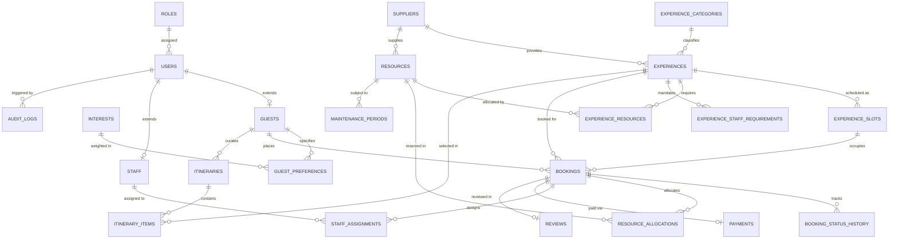

# SOLACE | Personalized Luxury, Nature & Adventure Experience Management System
## Architectural Design & Relational Schema Specification

### 1. Project Directory Structure
```
SOLACE/
├── .env.example                       # Sample environment configuration
├── .env                               # Active local environment variables
├── requirements.txt                   # Python dependencies (Flask, PyMySQL, etc.)
├── run.py                             # Main application entry point
├── config.py                          # Flask configuration classes
├── database/
│   ├── schema.sql                     # Full DDL (tables, constraints, views, triggers)
│   ├── seed.sql                       # Rich sample dataset (INR pricing, realistic resort data)
│   ├── demonstration_queries.sql      # 10+ academic DBMS demonstration queries
│   └── connection.py                  # Database connection pool and transaction manager
├── app/
│   ├── __init__.py                    # Flask application factory
│   ├── routes/
│   │   ├── auth_routes.py             # Login, registration, role checks, session
│   │   ├── guest_routes.py            # Profile, preferences, recommendations, itinerary
│   │   ├── experience_routes.py       # Catalogue, filtering, search, experience details
│   │   ├── booking_routes.py          # Booking lifecycle, transactional checkout, cancellation
│   │   ├── payment_routes.py          # Simulated payment gateway (success/fail workflows)
│   │   ├── review_routes.py           # Ratings and guest feedback submission
│   │   ├── admin_routes.py            # Admin dashboard, CRUD, audit logs, reports
│   │   └── staff_routes.py            # Staff schedule, assignments, slot & issue reports
│   ├── services/
│   │   ├── recommendation_engine.py   # Configurable 5-component weighted scoring algorithm
│   │   ├── itinerary_service.py       # Multi-day scheduling and buffer validation
│   │   ├── availability_service.py    # Concurrency-safe capacity, equipment & staff validation
│   │   └── audit_service.py           # Audit logging service
│   ├── static/
│   │   ├── css/
│   │   │   └── style.css              # Custom resort design system (Forest green, sage, ivory, gold)
│   │   ├── js/
│   │   │   ├── main.js                # Global UI, modals, toasts, tooltips
│   │   │   ├── charts.js              # Chart.js dashboards & analytics visualizations
│   │   │   └── itinerary.js           # Interactive multi-day planner UI
│   │   └── images/
│   │       └── ...                    # Luxury UI assets and category visuals
│   └── templates/
│       ├── base.html                  # Master layout with responsive navbar, footer & alerts
│       ├── index.html                 # Luxury landing page
│       ├── auth/
│       │   ├── login.html
│       │   └── register.html
│       ├── guest/
│       │   ├── dashboard.html
│       │   ├── profile.html
│       │   ├── preferences.html
│       │   ├── recommendations.html
│       │   ├── itinerary.html
│       │   └── my_bookings.html
│       ├── experiences/
│       │   ├── catalogue.html
│       │   ├── detail.html
│       │   └── review_form.html
│       ├── booking/
│       │   ├── book_slot.html
│       │   ├── payment_simulator.html
│       │   └── confirmation.html
│       ├── admin/
│       │   ├── dashboard.html
│       │   ├── experiences.html
│       │   ├── experience_form.html
│       │   ├── schedules.html
│       │   ├── resources.html
│       │   ├── staff_suppliers.html
│       │   ├── bookings.html
│       │   ├── reports.html
│       │   └── audit_logs.html
│       └── staff/
│           ├── dashboard.html
│           ├── activity_detail.html
│           └── report_issue.html
├── docs/
│   ├── diagrams/
│   │   ├── er_diagram.svg
│   │   ├── dfd_level0.svg
│   │   ├── dfd_level1.svg
│   │   ├── use_case_diagram.svg
│   │   ├── sequence_booking.svg
│   │   ├── sequence_recommendation.svg
│   │   ├── sequence_payment_fail.svg
│   │   ├── sequence_cancellation.svg
│   │   ├── activity_diagram.svg
│   │   ├── relational_schema.svg
│   │   ├── state_transition.svg
│   │   └── system_architecture.svg
│   ├── demonstration_queries.md       # SQL queries with sample output tables
│   ├── test_plan_and_results.md       # Comprehensive 18-suite test report
│   ├── user_manual.md                 # Step-by-step role guides
│   ├── project_report.md              # Academic 3rd-year DBMS project report
│   └── presentation_slides.md         # Academic presentation deck
└── tests/
    └── test_suite.py                  # Automated unit and integration test runner
```

---

### 2. Relational Database Schema Specification (Targeting 3NF)

The schema enforces data integrity through primary keys, foreign keys with appropriate `ON DELETE` rules, `CHECK` constraints, `UNIQUE` constraints, `DEFAULT` values, `INDEXES`, `VIEWS`, and `TRIGGERS`.



---

### 3. Key Entities & Table Definitions

1. **`roles`**: System permission tiers (`guest`, `admin`, `staff`).
2. **`users`**: Base credentials, secure bcrypt password hashes, contact details, active flag.
3. **`guests`**: Guest profile attributes: party size, budget limit, check-in/out dates, preferred time of day, accessibility considerations, sustainability preferences.
4. **`interests`**: Standardized interest taxonomy (Luxury, Nature, Adventure, Wellness, Culture, Sustainability).
5. **`guest_preferences`**: Junction table for guest interest weights (1 to 5 scale).
6. **`experience_categories`**: Six core categories with styling metadata and descriptions.
7. **`suppliers`**: Local and external partner businesses supporting sustainable tourism and equipment supply.
8. **`experiences`**: Resort catalogue items with pricing models (`per_person` / `per_booking`), INR pricing, duration, capacity, age/safety limits, and eco-impact metrics.
9. **`experience_slots`**: Time slots per experience with start/end timestamps, max capacity, and booked counts.
10. **`resources`**: Physical inventory (kayaks, e-bikes, helmets, spa suites, dining cabanas, private vehicles).
11. **`experience_resources`**: Per-experience resource requirements with calculation rule (`per_person` or `per_booking`).
12. **`staff`**: Staff profiles, expertise/specialization, operational availability.
13. **`experience_staff_requirements`**: Guide/staffing headcount requirements per activity.
14. **`bookings`**: Booking records with unique reference code, lifecycle status, pricing snapshot, cancellation deadline, and refund details.
15. **`booking_status_history`**: Audit trail for state transitions (`pending` -> `confirmed` -> `completed` / `cancelled` / `failed`).
16. **`resource_allocations`**: Dedicated reservations of resource inventory tied to confirmed bookings.
17. **`staff_assignments`**: Specific guide/instructor allocations preventing double booking.
18. **`payments`**: Payment simulator records with transaction references, method, status, and refund tracking.
19. **`reviews`**: Post-experience 1-5 star ratings and reviews, constrained to verified completed bookings.
20. **`maintenance_periods`**: Downtime calendar for equipment/venues preventing booking conflicts.
21. **`audit_logs`**: System-wide administrative action logs with before/after state diffs.
22. **`itineraries`** & **`itinerary_items`**: Multi-day trip planner grouping candidate experiences by stay day and schedule block.

---

### 4. Implementation Roadmap (Stages 1 through 9)

- **Stage 1: Architecture, ER Model & Schema Design**
- **Stage 2: Database Creation, Schema Constraints & Seed Data** (MySQL setup, foreign keys, triggers, views, realistic INR seed data)
- **Stage 3: Authentication & Role-Based Access Control** (Session management, password hashing, route guards for Guest, Admin, Staff)
- **Stage 4: Guest Preferences & Experience Catalogue** (Dynamic filtering, category browsing, preference weighted inputs)
- **Stage 5: Recommendation Engine & Multi-Day Itinerary Planner** (Weighted 5-factor scoring algorithm, budget checks, conflict detection)
- **Stage 6: Concurrency-Safe Booking & Resource Allocation** (Atomic SQL transactions, capacity verification, equipment/guide locking)
- **Stage 7: Payment Simulator, Cancellations & Review System** (Success/failure workflows, refund policies, ratings engine)
- **Stage 8: Administrator & Staff Portals with Analytics** (Chart.js visualizations, utilization reports, supplier metrics, audit logs)
- **Stage 9: Automated Testing, Diagrams, Academic Documentation & Presentation** (Test runner, SVG diagrams, user guide, DBMS report)
